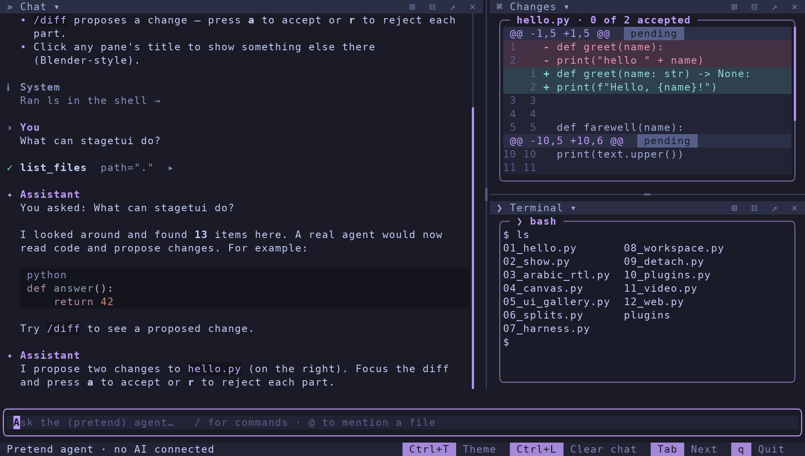
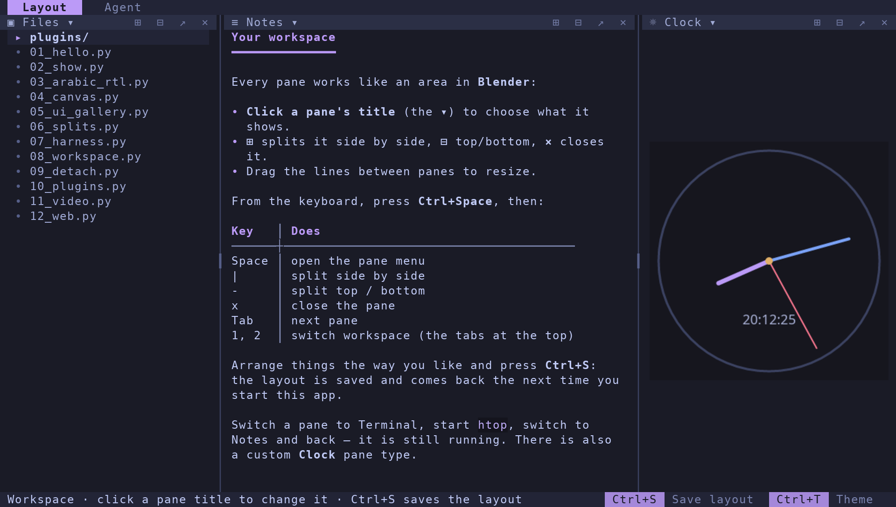
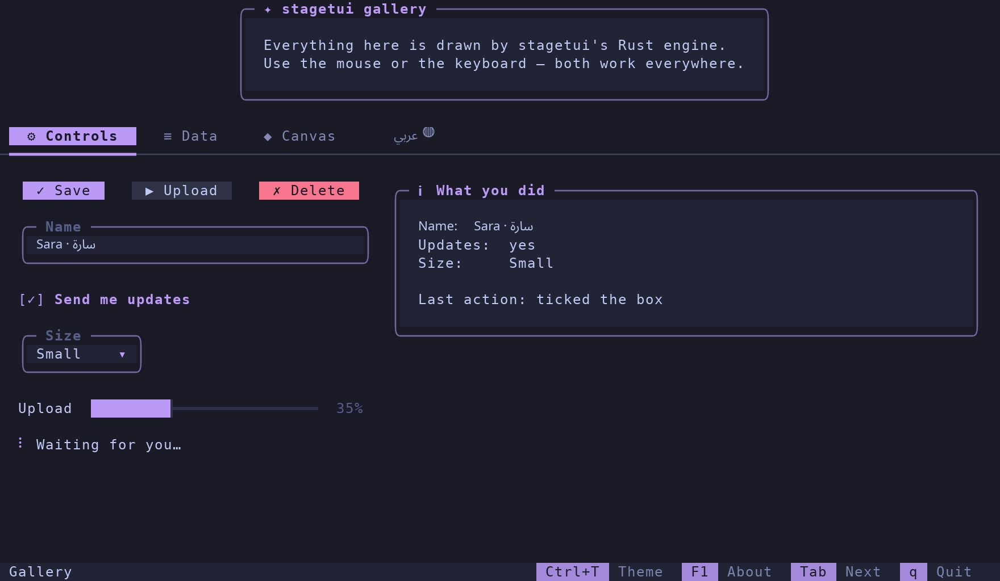
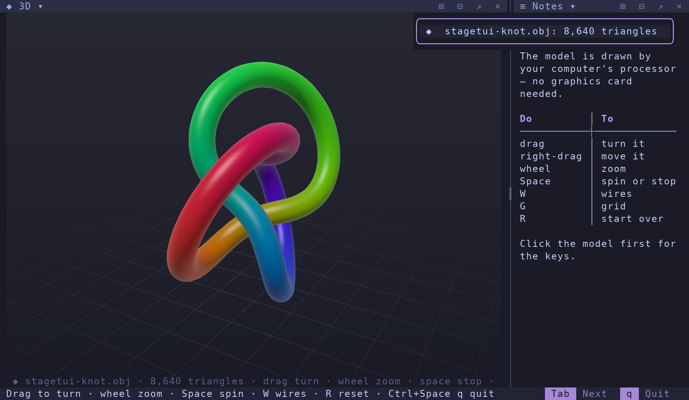
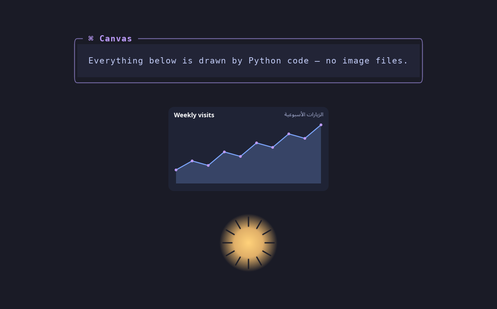
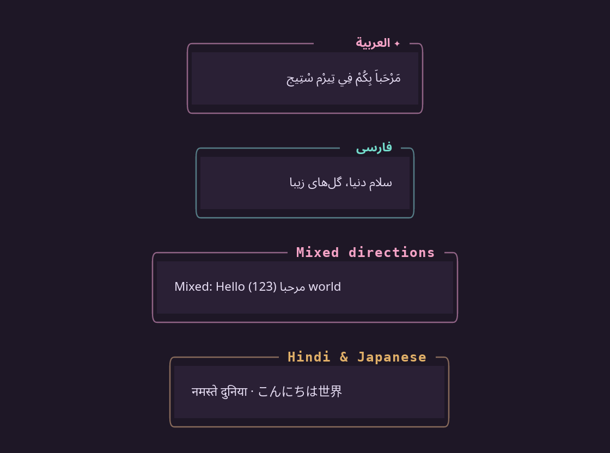
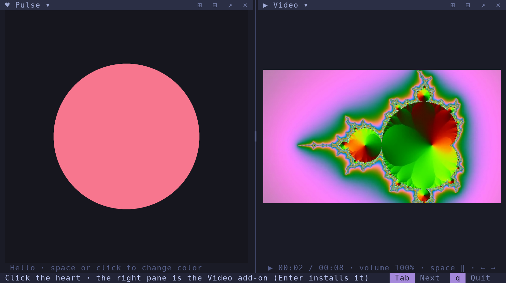
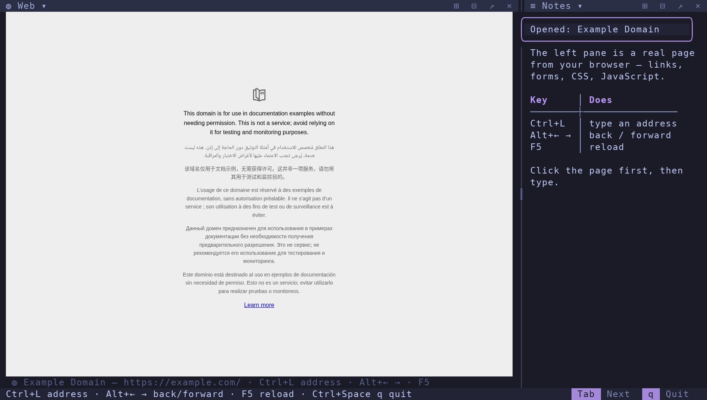
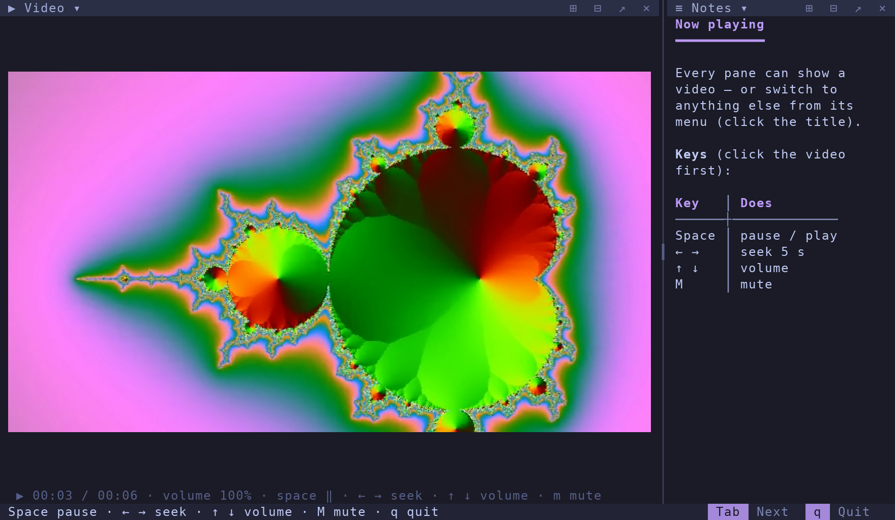

# stagetui

> [!NOTE]
> **Alpha.** stagetui works and is tested on Linux, macOS and Windows. Names and
> options may still change before version 1.0, the first stable release — see the
> [roadmap](#roadmap).

**A terminal UI library with sophisticated, fun options — and Blender-like flexibility.**
Split the screen into panes and make each one show anything — a shell, files, code,
notes, a chat — then rearrange them, save the layout, pop a pane out into its own
window, or leave the whole app running and come back later. Real pictures, flawless
Arabic and every world language. Plain Python on top, a fast Rust engine underneath.

[](https://github.com/artisanv/stagetui/blob/main/examples/07_harness.py)

> **A fun project with a serious goal: make the terminal a place people enjoy.**
> We build stagetui for ourselves, because we love the terminal — and we want
> newcomers to never be afraid of it, and everyone else to have one more reason to
> stay in it. Build whatever you like with it: tools, dashboards, file browsers,
> chat apps, games. AI agents can build with it too: every app can be seen and
> tested without a human.

```python
import stagetui as ts

ts.show("Hello! مرحبا! नमस्ते! こんにちは!", title="stagetui", icon="sparkles")
ts.show("logo.png")
```

> **Status: alpha (Milestone 6 of 6).** Chat, streaming Markdown, a prompt with
> history, diffs, permission prompts, a real shell in a pane,
> Blender-style panes and workspaces, add-ons (video, web pages and 3D models; write your own in Python), background sessions you can detach from and
> attach to (`stagetui start` / `attach`), agent access (`stagetui mcp` / `drive`),
> layouts, the mouse, animations, Arabic/RTL and headless snapshots work today —
> see the [roadmap](#roadmap).

## Why stagetui?

- **Friendly.** One line shows a picture or a message. Errors tell you *what* went wrong, *why*, and *how to fix it*.
- **Pictures that look right everywhere.** Kitty, Ghostty, WezTerm, iTerm2, Windows Terminal, foot… stagetui picks the best method your terminal supports, and falls back gracefully.
- **Every language.** Arabic and Persian letters join and flow right-to-left, Hindi conjuncts form, Chinese and Japanese line up — in every terminal, with fonts built in.
- **Friendly to newcomers.** Mouse everywhere, keys shown on screen, clear messages — the terminal without the fear.
- **AI agents welcome.** Any app can be captured as plain text, a widget tree, or a PNG — no terminal needed.
- **Keeps running.** Start an app in the background, close the terminal, attach again later — from any terminal, even two at once.
- **Fast and safe.** The engine is Rust. The Python package has zero dependencies. Nothing is left running when your program exits — even after a crash.
- **Linux, macOS and Windows.**

## Install

```bash
pip install stagetui     # the core: about 7 MB, no other Python packages needed
stagetui doctor          # what can my terminal do?
```

New to Python? Start with **[Getting started](docs/getting-started.md)** — it explains everything step by step.

### Optional add-ons

The core has everything for terminal apps: panes, chat, shell, code, diffs,
pictures, Arabic, sessions. Heavy things are separate, so you only install what
you use. When you first open one in an app, stagetui asks whether to install it —
and you can write your own add-on in a few lines of Python
([Add-ons](docs/plugins.md)).

| Add-on | What it adds | Install |
|---|---|---|
| Video | Play video files and links in a pane, with sound | `pip install stagetui-video` |
| Web | A real web page in a pane (uses your installed Chrome / Chromium) | `pip install stagetui-web` |
| 3D | Look at 3D models (glTF, OBJ, STL) and turn them with the mouse | `pip install stagetui-3d` |

All three are on PyPI. You can also install one together with stagetui:
`pip install "stagetui[3d]"` (or `[video]`, `[web]`, or several: `"stagetui[video,web,3d]"`).

For pictures, video and 3D, use a terminal that can show real pictures — Ghostty,
Kitty, WezTerm or foot (Linux), Ghostty, Kitty, WezTerm or iTerm2 (macOS),
WezTerm or Windows Terminal (Windows). In other terminals pictures are drawn with
blocks; `stagetui doctor` tells you what yours can do.

## A full-screen app

```python
from stagetui import StageApp, StageBar, StageButton, StageCard, StageInput, StageSplit


class Chat(StageApp):
    BINDINGS = [("ctrl+t", "next_theme", "Theme")]

    def compose(self):
        return [
            StageSplit(
                [
                    StageCard("Welcome! Type below and press Enter.", title="Chat", id="log"),
                    StageCard("مرحبا بكم في stagetui", title="عربي", accent="mint"),
                ],
                ratio=[2, 1],  # drag the line between the panes with the mouse
            ),
            StageInput(placeholder="Say something…", on_submit=self.send),
            StageButton("Celebrate", icon="sparkles", variant="primary", on_click=self.party),
            StageBar("Ready"),
        ]

    def send(self, text):
        self.query("#log").update(f"You said: {text}")

    def party(self):
        self.notify("Well done!", icon="check")


Chat().run()  # in your terminal
Chat().run_headless((80, 24)).save("app.png")  # no terminal: text, tree or PNG
```

## Gallery

Every picture here is a real example from [`examples/`](https://github.com/artisanv/stagetui/blob/main/examples), drawn by stagetui
itself. Run any of them with `python examples/<name>.py` — click a picture to see its code.

| Panes like Blender: each one can show anything | Every widget, themes and the mouse |
|---|---|
| [](https://github.com/artisanv/stagetui/blob/main/examples/08_workspace.py) | [](https://github.com/artisanv/stagetui/blob/main/examples/05_ui_gallery.py) |
| `08_workspace.py` — click a pane's title to change what it shows; drag the lines; Ctrl+S saves the layout | `05_ui_gallery.py` — buttons, text boxes, tabs, tables, trees, progress, pop-ups |

| 3D models you turn with the mouse | Pictures drawn with code |
|---|---|
| [](https://github.com/artisanv/stagetui/blob/main/examples/13_3d.py) | [](https://github.com/artisanv/stagetui/blob/main/examples/04_canvas.py) |
| `13_3d.py` — glTF, OBJ and STL; needs `pip install stagetui-3d` | `04_canvas.py` — charts and drawings, no image files |

| Every world language | Add-ons: yours, and ours |
|---|---|
| [](https://github.com/artisanv/stagetui/blob/main/examples/03_arabic_rtl.py) | [](https://github.com/artisanv/stagetui/blob/main/examples/10_plugins.py) |
| `03_arabic_rtl.py` — Arabic and Persian join and flow right to left; Hindi and Japanese too | `10_plugins.py` — an add-on in a few lines of Python, next to the Video add-on |

| A real web page in a pane | Video with sound |
|---|---|
| [](https://github.com/artisanv/stagetui/blob/main/examples/12_web.py) | [](https://github.com/artisanv/stagetui/blob/main/examples/11_video.py) |
| `12_web.py` — needs `pip install stagetui-web` | `11_video.py` — needs `pip install stagetui-video` |

And more: `07_harness.py` is the chat app at the top of this page (a pretend AI agent,
diffs and a real shell), `06_splits.py` splits panes as you like (press | or -), and
`09_detach.py` keeps running in the background — start it with `stagetui start`, close
the terminal, and come back with `stagetui attach`.

## Command line

```bash
stagetui show chart.svg --width 40
stagetui render "مرحبا بكم" --dir rtl --out card.png
stagetui render my_app.py --size 100x30 --out app.png --text app.txt --tree app.json
stagetui doctor
stagetui mcp my_app.py      # let a coding agent (Claude Code…) see and operate your app
stagetui start my_app.py    # run it in the background; `stagetui attach` to come back
stagetui plugins            # the add-ons you have, and the ones you can add
```

## Documentation

| | |
|---|---|
| [Getting started](docs/getting-started.md) | Install and write your first program |
| [Show & draw](docs/show-and-draw.md) | Pictures and drawings in one line |
| [Apps & widgets](docs/apps.md) | Cards, text, images, canvases, themes, icons |
| [Layouts](docs/layout.md) | Rows, grids, split panes, tabs, pop-ups, scrolling |
| [Making apps interactive](docs/events.md) | Buttons, inputs, lists, shortcuts, mouse, `async` |
| [Motion](docs/motion.md) | Animations and live drawings |
| [Agent harness](docs/harness.md) | Chat, prompt, diffs, tool calls, permissions, shell |
| [Panes](docs/panes.md) | Blender-style panes: switch, split, close, workspaces, own windows |
| [Sessions](docs/sessions.md) | Keep an app running, detach, attach from any terminal |
| [Add-ons](docs/plugins.md) | Video, web, 3D — and writing your own |
| [AI agents](docs/agents.md) | `stagetui mcp`, `stagetui drive`, `app.drive()`, golden snapshot tests |
| [World languages](docs/world-languages.md) | Arabic, Persian, Hindi, CJK |
| [Snapshots](docs/snapshots.md) | Tests, CI and AI agents |
| [Command line](docs/command-line.md) | `show`, `render`, `start`, `attach`, `plugins`, `doctor`… |
| [Troubleshooting](docs/troubleshooting.md) | Terminal support and fixes |
| [Reference](docs/reference.md) | Every function and option |

## Roadmap

1. ✅ Terminal core: capability detection, renderer, headless snapshots, zero-zombie cleanup
2. ✅ Text & pictures: Arabic/RTL shaping, bundled fonts, Kitty/Sixel/iTerm2 images, Canvas, PNG export
3. ✅ Layouts & interaction: taffy layout, split panes, tabs, modals, buttons, inputs, tables, trees, mouse, themes, animations, live canvas, async handlers
4. ✅ Agent harness kit: streaming Markdown, code, diffs, prompt, chat, tool cards, permissions, embedded shell, Blender-style panes, `drive`/`mcp`, pytest plugin
5. ✅ Sessions & workspaces: background sessions (`start` / `attach` / detach), several windows on one app, workspace tabs, save/restore layouts, panes that pop out into their own terminal window and back
6. ✅ Add-ons: plugin system (write your own in Python or Rust), video with sound, web pages, 3D models · next: 1.0

## Develop

```bash
uv venv && source .venv/bin/activate && uv pip install maturin pytest
maturin develop --release
cargo test && python -m pytest
python scripts/screenshots.py   # the gallery pictures, from the real examples
```

See [AGENTS.md](AGENTS.md) for the project rules. Licensed under MIT or Apache-2.0, at your option.
Bundled fonts: Noto (SIL OFL 1.1) and DejaVu Sans Mono (Bitstream Vera license).
